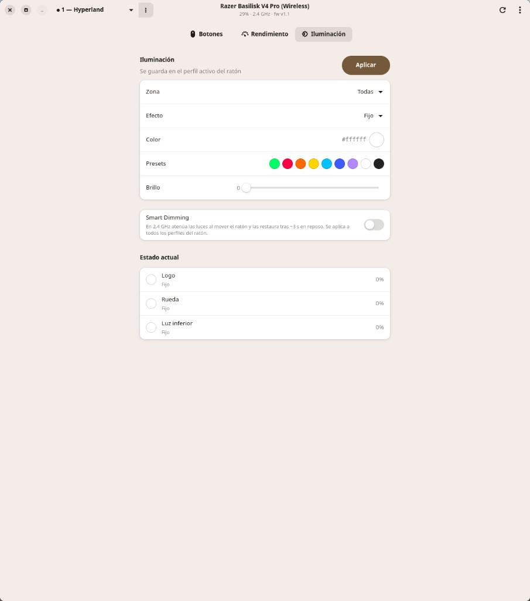

# Synapsex

**Razer Synapse for Linux** — unofficial GTK4/libadwaita control app for the [Razer Basilisk V4 Pro](https://www.razer.com/).

The trailing **x** nods to Tux. Settings are written into the mouse’s onboard memory and keep working with the app closed.

> Not affiliated with Razer Inc.



## Features

- **Onboard profiles** — create, rename, delete and switch firmware slots; the UI follows the mouse profile button
- **Button remaps** — normal + HyperShift layers from hardware; mouse actions, media keys, and keyboard binds (F1–F24, Super+/Alt+/Ctrl+…) for compositor shortcuts (Hyprland, etc.)
- **DPI & stages** — set current DPI and the onboard stage list; cycle with the DPI button
- **Polling rate** — configure report rate over USB / HyperSpeed
- **Zoned lighting** — Logo, Wheel and Underglow; static / spectrum / breathing / etc., with color picker and brightness
- **Scroll wheel** — Smart-Reel, scroll acceleration, free-spin / tactile mode
- **Power** — battery level, idle sleep, low-battery threshold
- **GTK4 / libadwaita UI** — Spanish by default, English when `LANG=en*`
- **CLI** — scriptable `synapsex-cli` for probes and automation
- **Userspace hidraw** — no kernel driver / OpenRazer daemon required

## Supported hardware

| Connection | USB IDs | Supported |
|---|---|---|
| USB cable | `1532:00E2` | Yes |
| HyperSpeed 2.4 GHz dongle | `1532:00E3` | Yes |
| Bluetooth | `1532:00E4` | No — Razer does not expose vendor HID reports over BT |

Configure the mouse over the cable or the HyperSpeed dongle. Bluetooth stays a connection, not a configuration channel.

## Requirements

- Linux (developed on Arch + Hyprland)
- `rust`, `gtk4`, `libadwaita`, `pkgconf`

## Arch Linux

A `synapsex-git` PKGBUILD lives in [`packaging/aur/synapsex-git/`](packaging/aur/synapsex-git/). Until it is on the AUR:

```sh
git clone https://github.com/iMacnucintosh/synapsex.git
cd synapsex/packaging/aur/synapsex-git
makepkg -si
```

Or install from a source checkout with `cargo` as below.

## Permissions

The mouse is a hidraw device. Copy the udev rule, reload, and replug:

```sh
sudo cp packaging/99-synapsex.rules /etc/udev/rules.d/
sudo udevadm control --reload-rules
sudo udevadm trigger
# log out/in or replug the dongle if /dev/hidraw* is still root-only
```

The AUR package installs the same rule to `/usr/lib/udev/rules.d/`.

## Build

```sh
cargo build --release
```

| Binary | Role |
|---|---|
| `target/release/synapsex` | GTK4 app |
| `target/release/synapsex-cli` | CLI probe / configure |

Install onto `PATH` (needed by the desktop entry):

```sh
install -Dm755 target/release/synapsex ~/.local/bin/synapsex
install -Dm755 target/release/synapsex-cli ~/.local/bin/synapsex-cli
install -Dm644 packaging/synapsex.desktop ~/.local/share/applications/synapsex.desktop
update-desktop-database ~/.local/share/applications 2>/dev/null || true
```

`~/.local/bin` must be on your `PATH`. Rebuild after UI changes: `cargo build --release -p synapsex-ui`.

## CLI examples

```sh
synapsex-cli list
synapsex-cli info
synapsex-cli battery
synapsex-cli dpi --set 1600
synapsex-cli poll --set 1000
synapsex-cli rgb --zone all --effect static --color ff0033 --brightness 80
synapsex-cli slots
synapsex-cli slots --activate 2
synapsex-cli slots --watch
synapsex-cli buttons
synapsex-cli buttons --set "Side Front" --to "F6"
```

## Profiles and lighting

Onboard slots **are** the profiles. Lighting, DPI, wheel and remaps are stored in the **active** slot. Changing profile with the mouse button (or the app dropdown) switches the slot in firmware; the UI reloads state from the device.

Friendly profile names live in `~/.config/synapsex/config.json` (the mouse does not store names).

## Project layout

```
crates/
  razer-protocol/   # HID report framing & Basilisk V4 Pro commands
  razer-device/     # hidraw transport + device session
  synapsex-i18n/    # ES/EN strings
  synapsex-cli/     # synapsex-cli binary
  synapsex-ui/      # synapsex GTK UI
packaging/          # udev rules, .desktop, AUR PKGBUILD
docs/screenshots/   # README images
```

## License

GPL-2.0-or-later. See [LICENSE](LICENSE) and [NOTICE.md](NOTICE.md).

Razer, Synapse, HyperSpeed and Basilisk are trademarks of Razer Inc.
